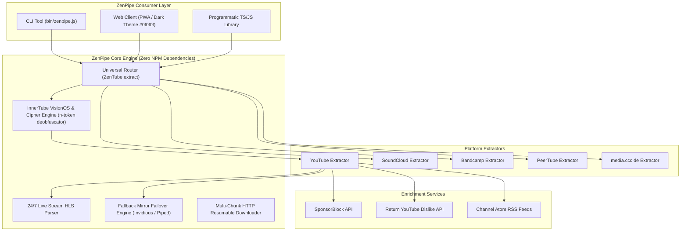

<div align="center">

# ⚡ ZenPipe

### Universal Media Streaming Engine, CLI Suite & Flagship Web Client
**Zero NPM runtime dependencies • Multi-platform • Privacy-first • 100% Free & Open Source**

[](https://github.com/VarshuAi/zen-pipe/actions/workflows/ci.yml)
[](https://www.gnu.org/licenses/gpl-3.0)
[](https://nodejs.org)
[](https://github.com/VarshuAi/zen-pipe)
[](https://github.com/VarshuAi/zen-pipe)
[](https://zen-pipe.vercel.app/)
[](https://github.com/VarshuAi/zen-pipe)

[**Explore Live Web App (Vercel)**](https://zen-pipe.vercel.app/) • [**CLI Guide**](#-cli-usage) • [**Architecture**](#-architecture) • [**Cloud & Vercel Deployment**](#-cloud-deployment--cookie-configuration) • [**Docker Self-Hosting**](#-docker--self-hosting) • [**Contributing**](./CONTRIBUTING.md)

</div>

---

## 📖 Overview

**ZenPipe** is a high-performance media extraction engine, universal streaming server, command-line interface, and authentic desktop YouTube client. Engineered with **zero external NPM dependencies**, ZenPipe runs directly on native Node.js 22/24 using `--experimental-strip-types`, delivering unmatched speed, complete auditability, and immunity to supply-chain vulnerabilities.

ZenPipe seamlessly extracts high-definition video streams (up to 4K 60fps), audio tracks (Opus & AAC), 24/7 live HLS streams, timestamped transcripts, comments, and playlists across 5 premier media networks:
1. **YouTube** (VOD, 24/7 Live HLS, Shorts, Playlists, Channels, Comments, Transcripts)
2. **SoundCloud** (Direct 128k MP3 streaming, discographies, track comments)
3. **Bandcamp** (Albums, track releases, high-res album art)
4. **PeerTube** (Federated instances, direct MP4 & HLS video networks)
5. **media.ccc.de** (Chaos Computer Club conference archives & CDN streams)

---

## 🏆 Feature Comparison

| Feature | ZenPipe | Invidious | NewPipe | Cobalt | FreeTube |
| :--- | :---: | :---: | :---: | :---: | :---: |
| **External NPM Runtime Deps** | **0 (Zero)** | N/A (Crystal) | N/A (Java) | Many (Node) | Many (Electron) |
| **Supported Platforms** | **5 Platforms** (YT, SC, BC, PT, CCC) | 1 (YouTube) | 5 Platforms | 10+ (Downloader only) | 1 (YouTube) |
| **Interactive Web Client** | **Included** (PWA Dark Theme) | Included | Android Only | Download Web | Desktop Only |
| **Built-in CLI Tool** | **`zenpipe` CLI** | None | None | CLI | None |
| **Atmospheric Ambient Light** | **Real-time 15fps Canvas Glow** | ❌ | ❌ | ❌ | ❌ |
| **Cinema Theater Mode** | **One-click (`t`)** | Basic | ❌ | ❌ | Yes |
| **Audio-Only Data Saver** | **Vinyl Visualizer Mode (`q`)** | ❌ | Yes (Mobile) | Audio download | Yes |
| **Community Integrations** | **SponsorBlock + Return YouTube Dislike** | Partial | Partial | ❌ | Yes |
| **Studio DSP Equalizer** | **Web Audio 5-Band + Karaoke DSP** | ❌ | ❌ | ❌ | ❌ |
| **A-B Repeat Looper** | **Sub-second precision (`[`, `]`, `\`)** | ❌ | ❌ | ❌ | ❌ |
| **Automated Failover Mirrors** | **Invidious & Piped Failover Engine** | Manual | ❌ | ❌ | Invidious API |
| **Subscription Privacy** | **OPML & NewPipe JSON Zero-Cloud** | Database | Local SQLite | ❌ | Local PouchDB |
| **Docker & Self-Hosting** | **Alpine Multi-Stage Container** | Complex | N/A | Docker | N/A |

---

## 🏛 Architecture



---

## ⚡ Quick Start

### 1. Run with Node.js 22 or 24+

```bash
# Clone the repository
git clone https://github.com/VarshuAi/zen-pipe.git
cd zen-pipe

# Start the web client & API server
npm start
```

Visit **`http://localhost:3333`** in your browser.

### 2. Run All Automated Tests (98 Tests Passing)

```bash
# Run core test suite (92 tests)
npm test

# Run extended features test suite (6 tests)
npm run test:features

# Run complete test matrix
npm run test:all
```

---

## 💻 CLI Usage

The `zenpipe` executable provides instantaneous media playback, searching, transcripts, and downloads right from your terminal.

```bash
# Display help and available commands
node bin/zenpipe.js --help

# 1. Stream video or audio stream URL directly
node bin/zenpipe.js stream jNQXAC9IVRw

# 2. Universal extraction (Auto-detects SoundCloud, Bandcamp, PeerTube, MediaCCC)
node bin/zenpipe.js stream "https://peertube.tv/w/52364"
node bin/zenpipe.js stream "https://media.ccc.de/v/bob11-2026-swift-ui-chakravarty"
node bin/zenpipe.js stream "https://soundcloud.com/chillhopdotcom/saturn"

# 3. Search videos with platform filter
node bin/zenpipe.js search "lofi hip hop"
node bin/zenpipe.js search "synthwave" --platform soundcloud

# 4. Explore trending feeds by category and region
node bin/zenpipe.js trending music US
node bin/zenpipe.js trending gaming IN

# 5. Search autocomplete suggestions
node bin/zenpipe.js suggest "javascript tutorial"

# 6. Extract timestamped transcript & convert to SRT
node bin/zenpipe.js transcript jNQXAC9IVRw
node bin/zenpipe.js subtitles jNQXAC9IVRw srt

# 7. Extract YouTube Shorts vertical reels
node bin/zenpipe.js shorts

# 8. Check health of fallback mirrors (Invidious & Piped)
node bin/zenpipe.js mirrors

# 9. Download stream directly to disk with live progress
node bin/zenpipe.js download <streamUrl> ./video.mp4
```

---

## 🐳 Docker & Self-Hosting

ZenPipe provides an ultra-lightweight, production-grade Docker image based on **Alpine Linux Node 24**:

### One-Command Deployment with Docker Compose

```bash
docker compose up -d
```

### Manual Docker Build & Run

```bash
# Build the container
docker build -t zen-pipe .

# Run on port 3333 with automatic restart
docker run -d --name zenpipe -p 3333:3333 --restart unless-stopped zen-pipe
```

Verify container health:
```bash
curl http://localhost:3333/health
# Response: {"status":"healthy","uptime":12.4,"version":"1.0.0"}
```

---

## 🚀 Cloud Deployment & Cookie Configuration

ZenPipe is designed to run seamlessly both in local desktop/home server environments and on serverless cloud platforms like **Vercel**, **AWS Lambda**, **Render**, or **Railway**.

### Datacenter Anti-Bot Mitigation & Fallback Strategy

Google strictly restricts anonymous `/player` calls originating from commercial cloud datacenter IP subnets (AWS, GCP, Azure, Vercel) with `LOGIN_REQUIRED: Sign in to confirm you’re not a bot`. ZenPipe implements a 3-tier resilient failover architecture:

1. **Client Cascading (Tier 1)**: First queries Apple VisionOS (`visionOS 26.6`) for unthrottled streams, immediately falling back to Android (`21.26.364`) and iOS (`21.26.4`) payloads.
2. **Federated Mirrors (Tier 2)**: Automatic failover across registered Invidious and Piped instances sorted by lowest latency.
3. **Graceful Embedded Player Failover (Tier 3)**: If datacenter IP challenges occur and mirrors are unreachable, ZenPipe automatically returns rich video metadata alongside an ad-free, tracking-free `youtube-nocookie.com` embed player inside the custom ZenPipe shell. Playback **never breaks** with 500 errors.

### Unlocking Direct 4K Streams on Cloud Deployments

To bypass cloud datacenter challenges and unlock full, direct unthrottled 4K/1080p native stream formats on Vercel or Docker cloud servers:

1. Export YouTube cookies from a standard or throwaway Google account using a browser extension like *Get cookies.txt LOCALLY*.
2. Add the environment variable in your cloud deployment settings (e.g., **Vercel Dashboard &rarr; Project Settings &rarr; Environment Variables**):
   ```ini
   YOUTUBE_COOKIES="VISITOR_INFO1_LIVE=...; PREF=...; SID=...; HSID=...;"
   ```
3. ZenPipe's `HttpClient` automatically detects `process.env.YOUTUBE_COOKIES` and authenticates all outgoing InnerTube requests.

---

## 🎨 Flagship Web Experience

- **Atmospheric Ambient Backlight (`a`)**: Real-time canvas sampling at ~12.5fps with CSS Gaussian bloom blur.
- **Cinema Theater Mode (`t`)**: Expands video to full cinema container width without page reload.
- **Audio-Only Data Saver (`q`)**: Switches off video rendering, saving bandwidth with animated vinyl artwork.
- **Studio DSP Equalizer**: 5-band parametric biquad equalizer with Bass Punch (+9dB), Vocal Clarity, Treble Air, and real-time differential phase cancellation Karaoke vocal isolation.
- **A-B Precision Looper (`[`, `]`, `\`)**: Loop any video segment down to millisecond precision for music practice or tutorials.
- **Zero-Cloud Privacy**: History, bookmarks, and custom playlists stored 100% locally on your machine.
- **Progressive Web App (PWA)**: Full offline service worker caching for instant loading on desktop and mobile.

### Keyboard Shortcuts Cheatsheet

| Key | Action |
| :---: | :--- |
| <kbd>Space</kbd> / <kbd>k</kbd> | Play / Pause |
| <kbd>j</kbd> / <kbd>l</kbd> | Seek -10s / +10s |
| <kbd>&larr;</kbd> / <kbd>&rarr;</kbd> | Seek -5s / +5s |
| <kbd>m</kbd> | Mute / Unmute |
| <kbd>f</kbd> | Toggle Fullscreen |
| <kbd>t</kbd> | Toggle Cinema Theater Mode |
| <kbd>a</kbd> | Toggle Atmospheric Ambient Backlight |
| <kbd>q</kbd> | Toggle Audio-Only Data Saver |
| <kbd>p</kbd> | Picture-in-Picture |
| <kbd>[</kbd> / <kbd>]</kbd> | Set Loop Point A / B |
| <kbd>\</kbd> | Toggle A-B Repeat Loop |
| <kbd>&lt;</kbd> / <kbd>&gt;</kbd> | Playback Speed +/- |
| <kbd>/</kbd> | Focus Search Bar |
| <kbd>?</kbd> | Open Shortcuts Cheatsheet |

---

## 🔌 Programmatic API

```typescript
import { ZenTube } from 'zen-pipe';

// 1. Universal Media Extraction (Auto-detects URL)
const stream = await ZenTube.extract('https://www.youtube.com/watch?v=jNQXAC9IVRw');
console.log(stream.title, stream.videoStreams[0].url);

// 2. Fetch Search Suggestions
const suggestions = await ZenTube.getSuggestions('chillhop');

// 3. YouTube Shorts Feed
const shorts = await ZenTube.getShorts();

// 4. Trending Feed
const trending = await ZenTube.getTrending('music', 'US');

// 5. Channel Atom RSS Feed (Zero API keys)
const feed = await ZenTube.getChannelFeed('@NoCopyrightSounds');

// 6. Subtitles & Transcripts
const transcript = await ZenTube.getTranscript('jNQXAC9IVRw');
const srt = ZenTube.transcriptToSrt(transcript);
```

---

## 🤝 Contributing

Contributions are welcomed! Please see our [**Contributing Guide**](./CONTRIBUTING.md) for architectural guidelines, test procedures, and code standards.

---

## 📜 License

ZenPipe is released under the **GNU General Public License v3.0 (GPL-3.0)**. See the [LICENSE](./LICENSE) file for details.
